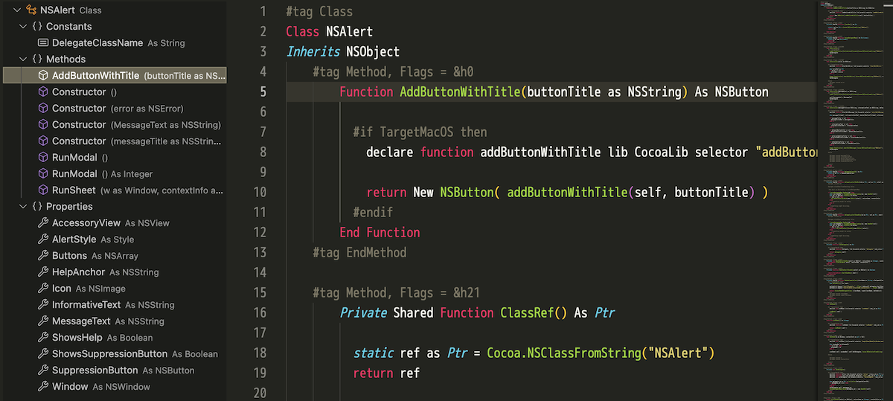

# Xojo Syntax Highlighting for VS Code

A lightweight syntax highlighting extension for the Xojo programming language.



## Features

### Syntax Highlighting

-   Comments (`'` / `//`, plus legacy `Rem`)
-   Strings with doubled quotes (`""`) inside literals
-   Decimal and exponent numbers; hexadecimal (`&h`), binary (`&b`), octal (`&o`), color (`&c`), and Unicode (`&u`) literals
-   Control flow, declaration modifiers, operators, and compiler directives (`#If`, `#Pragma`)
-   Subdued comment-style highlighting for project-file `#tag` metadata
-   Built-in types and Unicode characters after the first letter in identifiers
-   Function names (declarations and calls)

### Outline View (DocumentSymbolProvider)

-   **`.xojo_window`**: Window → Controls → Events/Methods/Properties/MenuHandlers
    -   Hierarchical control layout based on `InitialParent` attribute
    -   Display child controls under container controls like DesktopTabPanel
    -   `#tag Events` blocks with hierarchical support (correctly associates events with nested controls)
-   **`.xojo_code`**: Class/Module/Interface/Structure/Enum → Methods/Properties/Events/Constants
    -   Automatically applies appropriate group structure for each object type
    -   Supports both `#tag` blocks and free-form declarations
    -   Recognizes access modifiers, Shared methods, delegates, native Declares, array parameters, qualified types, and continued signatures
    -   Shows computed properties with Get/Set, event definitions separately from event handlers, and nested enums/structures
    -   Shows enum values and names stored in tag attributes
    -   Navigation targets the declaration name; notes, layout metadata, and method-local declarations do not become object members
-   **`.xojo_menu`**: Menu → DesktopMenuItem → (Submenu items)
    -   Recursively parses menu hierarchies
    -   Displays `Text` attribute as menu item details
    -   Special handling for separators (`Text = "-"`)
-   **`.xojo_library` API files**: Open Xojo files stored under the zipped library `API` folder as read-only virtual documents
    -   Use **Xojo: Open Library API File** from the Command Palette or the Explorer context menu
    -   The opened API file uses the same syntax highlighting and Outline support as normal `.xojo_code` / `.xojo_window` / `.xojo_menu` files
-   **Generic code files**: Flat list of Sub/Function/Method/Event/Delegate declarations

### Workspace Symbol Search

-   Use **Go to Symbol in Workspace** (`Cmd+T` on macOS, `Ctrl+T` on Windows/Linux) to find declarations across your project. Names support case-insensitive abbreviations, such as `fch` for `FetchCredential`.
-   Search classes, modules, methods, properties, events, delegates, enum values, controls, and menu items. Container names help distinguish repeated names; selecting a result takes you to its declaration.
-   All workspace folders are searched for `.xojo_code`, `.xojo_script`, `.xojo_window`, and `.xojo_menu` files. Open Xojo files, untitled documents, and opened library API documents are also included. Unopened library archives are not scanned.
-   Unsaved edits take priority. Results refresh on subsequent searches after saving, adding, renaming, or deleting source files or folders.
-   Unopened files follow VS Code's `files.exclude` setting; `search.exclude` does not control this index. Open Xojo documents remain searchable. Method-local declarations and Outline grouping labels are omitted.

### Color Previews and Picker

-   Color swatches appear beside `&cRRGGBB` and `&cRRGGBBAA` literals, including space-separated components such as `&c FF 00 00 7F`.
-   Hover over a swatch to open VS Code's color picker. Choosing a color updates the literal while preserving its prefix, component spacing, hex letter case, and explicit alpha component where possible. Transparency adds an alpha component to a six-digit literal when needed.
-   The opacity slider is converted to Xojo's transparency convention (`00` is opaque; `FF` is fully transparent).
-   Comments, strings, `#tag` headers, notes, and view metadata do not show swatches. Read-only library API documents support previews without replacement edits.
-   If swatches are hidden, enable **Editor: Color Decorators** in VS Code settings.

### Folding and Editing

-   Fold project tags, layout blocks, methods, objects, and multiline control flow, including conditional compilation. Closing lines stay visible.
-   Use **Toggle Line Comment** (`Cmd+/` on macOS, `Ctrl+/` on Windows/Linux) to add or remove apostrophe comments.
-   Indentation follows block openings, endings, and branches. Single-line conditions do not increase indentation.
-   Insert a snippet through **Snippets: Insert Snippet**, or type one of these prefixes and select the suggestion:

    `xojo-if`, `xojo-select`, `xojo-for`, `xojo-foreach`, `xojo-while`, `xojo-do`, `xojo-try`, `xojo-sub`, `xojo-function`, `xojo-const`, `xojo-ifdef`

    Use Tab to move between placeholders. Comments, strings, and legacy `Dim`/`Rem` syntax remain supported. New files must use the **Xojo** language mode for these editing features.

### Xojo Integration

Use **Xojo: Reload and Run** from the Command Palette, or F5 with a Xojo launch configuration. **Xojo: Create Default launch.json** creates a configuration without replacing an existing file.

With Xojo 2026r3 or later, save the project in text Xojo Format and enable **File > Agentic Mode** in Xojo. Saving in this format requires a Xojo license. Save your source changes before running. The extension creates `XojoRunProject.txt` beside the selected `.xojo_project`; Xojo automatically reloads changed files and consumes the run request. On macOS the extension opens the selected project first unless `openProject` is false. On Windows/Linux, open the selected project in Xojo yourself. If multiple projects share a directory, keep only the intended project open there: the request file identifies a directory, not an individual manifest.

The **Xojo: Run Mode** setting (`xojo.run.mode`) selects the protocol:

-   `auto` (default): use the file protocol when the saved manifest contains `AgenticMode=True`; otherwise use the existing macOS reload/run shortcuts.
-   `agentic`: explicitly use the file protocol. Enable Agentic Mode in Xojo first; the extension does not change the project manifest.
-   `legacy`: use the macOS shortcuts, including the existing delay options.

The project containing the active file is preferred, with the nearest enclosing project taking precedence. If the choice is ambiguous, select a project from the list. F5 searches within its launch workspace folder. Set `projectPath` to choose a manifest explicitly; relative paths are resolved against that folder (or the first workspace folder when none is specified).

```json
{
  "type": "xojo",
  "request": "launch",
  "name": "Xojo: Reload and Run",
  "runMode": "agentic",
  "projectPath": "MyApp.xojo_project",
  "openProject": false,
  "agenticTimeoutMs": 30000,
  "agenticErrorWaitMs": 10000
}
```

`runMode` overrides the workspace setting for that launch. By default, the extension waits up to 30 seconds for the request to disappear, then observes `XojoCompileErrors.txt` for 10 seconds. New or updated error output appears in **Output > Xojo**. An unchanged old error file is preserved and identified as old output. Acknowledgement or an observation window without new errors does not confirm compilation success or application behavior; check Xojo for later errors or longer builds. Errors are displayed as raw text, without Problems integration.

Overlapping requests in the same directory and pre-existing request files are not overwritten. Cancelling or timing out removes this extension's pending request when it still owns it. Once Xojo has consumed a request, cancelling only stops observation; it does not stop Xojo or its debug build. A timeout never retries through the legacy shortcuts.

## Installation

1. Open the VS Code Command Palette and run **Extensions: Install from VSIX…**.
2. Select `xojo-syntax-1.0.0.vsix`.
3. Open a supported Xojo file. For a new untitled file, select **Xojo** from the language mode selector.

You can also install from the command line:

```bash
code --install-extension xojo-syntax-1.0.0.vsix
```

To reinstall the same version, add `--force`.

## Supported Files

-   Language ID: `xojo`
-   Extensions: `.xojo_code`, `.xojo_script`, `.xojo_window`, `.xojo_menu`
-   Library API viewer: `.xojo_library` files can be opened with **Xojo: Open Library API File**

## Known Limitations

-   Not fully compatible with the official Xojo IDE
-   No type checking, target-specific conditional evaluation, formatting, or semantic code completion
-   Editing incomplete or malformed code uses best-effort structural recovery
-   `#` alone is not a comment marker; use an apostrophe or `//` for comments
-   `.xojo_library` support opens API text files from the archive; it does not edit or rewrite the library archive

## License

MIT
