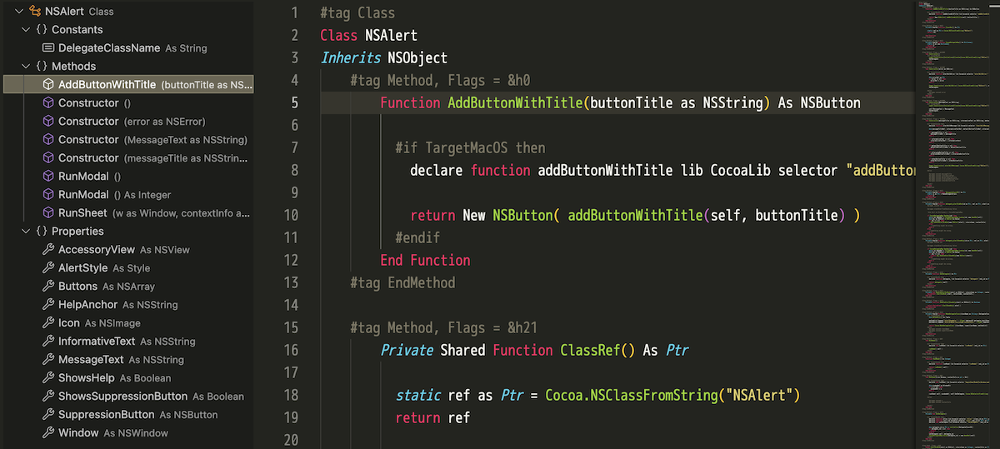

# Xojo Syntax Highlighting for VS Code

Xojo 言語向けの軽量なシンタックスハイライト拡張です。



## できること

### シンタックスハイライト

-   コメント（`'` / `//`、互換用の`Rem`）
-   文字列と、引用符を含めるための`""`表現
-   十進数・指数表記と、16進数（`&h`）・2進数（`&b`）・8進数（`&o`）・色（`&c`）・Unicode（`&u`）リテラル
-   制御構文・宣言修飾子・演算子・コンパイラ指示子（`#If`・`#Pragma`）
-   プロジェクト保存形式の`#tag`メタデータはコメント相当の控えめな表示
-   組み込み型と、識別子の先頭文字以外に使用したUnicode文字
-   関数名（宣言/呼び出し）

### アウトライン機能（DocumentSymbolProvider）

-   **`.xojo_window`**: Window → Controls → Events/Methods/Properties/MenuHandlers
    -   `InitialParent`属性による階層的なコントロール配置
    -   DesktopTabPanel 等のコンテナコントロール配下に子コントロールを表示
    -   `#tag Events`ブロックで階層対応（ネストされたコントロールのイベントを正しく親子付け）
-   **`.xojo_code`**: Class/Module/Interface/Structure/Enum → Methods/Properties/Events/Constants
    -   オブジェクト種別ごとに適切なグループ構造を自動適用
    -   `#tag`ブロックと自由形式の両方に対応
    -   アクセス修飾子・Sharedメソッド・デリゲート・ネイティブDeclare・配列引数・修飾型・行継続したシグネチャを認識
    -   計算プロパティのGet/Set、イベント実装とは区別したイベント定義、入れ子の列挙型・構造体を表示
    -   列挙値と、タグ属性に保存された名前を表示
    -   移動先は宣言名の位置。ノート・レイアウトのメタデータ・メソッド内のローカル宣言はオブジェクトのメンバーとして表示しない
-   **`.xojo_menu`**: Menu → DesktopMenuItem → (サブメニュー項目)
    -   メニュー階層を再帰的に解析
    -   `Text`属性をメニュー項目の詳細情報として表示
    -   セパレーター（`Text = "-"`）を特別扱い
-   **`.xojo_library` APIファイル**: zip形式のライブラリ内の`API`配下にあるXojoファイルを読み取り専用の仮想ドキュメントとして開く
    -   コマンドパレットまたは Explorer のコンテキストメニューから **Xojo: Open Library API File** を実行
    -   開いたAPIファイルには通常の `.xojo_code` / `.xojo_window` / `.xojo_menu` と同じシンタックスハイライトとアウトライン機能を適用
-   **汎用コードファイル**: Sub/Function/Method/Event/Delegate のフラットリスト

### ワークスペースのシンボル検索

-   **ワークスペース内のシンボルへ移動**（macOSは`Cmd+T`、Windows/Linuxは`Ctrl+T`）で、プロジェクト全体の宣言を検索できます。大文字小文字を区別せず、`FetchCredential`を`fch`で探すような省略入力にも対応します。
-   クラス・モジュール・メソッド・プロパティ・イベント・デリゲート・列挙値・コントロール・メニュー項目を検索します。同名の項目は所属先で区別でき、結果を選択すると宣言位置へ移動します。
-   ワークスペース内のすべてのフォルダーで`.xojo_code`・`.xojo_script`・`.xojo_window`・`.xojo_menu`を検索します。開いているXojoファイル、無題の文書、開いたライブラリAPI文書も対象です。未展開のライブラリアーカイブは走査しません。
-   未保存の編集内容を優先します。ソースファイルやフォルダーの保存・追加・名前変更・削除後は、次の検索から結果へ反映します。
-   開いていないファイルの除外にはVS Codeの`files.exclude`を使います。`search.exclude`はこの索引に適用しません。開いているXojo文書は引き続き検索対象です。メソッド内のローカル宣言と、アウトラインの分類見出しは検索結果に含めません。

### 色プレビューとカラーピッカー

-   `&cRRGGBB`・`&cRRGGBBAA`の横に色見本を表示します。`&c FF 00 00 7F`のように成分を空白で区切る表記にも対応します。
-   色見本にマウスを重ねるとVS Codeのカラーピッカーが開きます。色を選択すると、接頭辞・成分間の空白・16進文字の大小・明示された透明度成分を可能な範囲で保持してリテラルを更新します。6桁の表記で透明度が必要になった場合は、透明度成分を追加します。
-   不透明度スライダーの値は、Xojoの透明度表現（`00`が不透明、`FF`が完全透明）に変換します。
-   コメント・文字列・`#tag`行・ノート・ビューのメタデータには色見本を表示しません。読み取り専用のライブラリAPIではプレビューのみを提供し、置換編集は提示しません。
-   色見本が表示されない場合は、VS Codeの設定で**Editor: Color Decorators**を有効にしてください。

### 折りたたみと入力支援

-   プロジェクトのタグ、レイアウト、メソッド、オブジェクト、条件コンパイルを含む複数行の制御構文を折りたたみ、終了行を表示に残します。
-   **行コメントの切り替え**（macOSは`Cmd+/`、Windows/Linuxは`Ctrl+/`）でアポストロフィのコメントを追加・解除できます。
-   ブロックの開始・終了・分岐に応じてインデントします。単行の条件文ではインデントを増やしません。
-   **スニペット: スニペットの挿入**を実行するか、次のプレフィックスを入力して候補を選択します。

    `xojo-if`, `xojo-select`, `xojo-for`, `xojo-foreach`, `xojo-while`, `xojo-do`, `xojo-try`, `xojo-sub`, `xojo-function`, `xojo-const`, `xojo-ifdef`

    Tabで入力項目を移動できます。コメント・文字列・従来の`Dim`/`Rem`記法にも引き続き対応します。新規ファイルで入力支援を使う場合は、言語モードを**Xojo**に設定してください。

### Xojo 連携機能

コマンドパレットの **Xojo: Reload and Run**、またはXojoの起動構成を使ったF5で実行できます。**Xojo: Create Default launch.json**は、既存ファイルを置き換えずに起動構成を作成します。

Xojo 2026r3以降では、プロジェクトをテキストのXojo Formatで保存し、Xojoの **File > Agentic Mode** を有効にしてください。この形式での保存にはXojoライセンスが必要です。実行前にソースの変更を保存してください。拡張機能は選択した`.xojo_project`と同じフォルダーに`XojoRunProject.txt`を作成し、Xojoが変更ファイルを自動で再読み込みして実行要求を処理します。macOSでは、`openProject`がfalseでない限り、先に対象プロジェクトを開きます。Windows/Linuxでは、対象プロジェクトを自分でXojoで開いてください。複数のプロジェクトが同じフォルダーにある場合、そのフォルダーでは実行したいプロジェクトだけを開いてください。要求ファイルは個々のマニフェストではなくフォルダーを指定する仕組みです。

設定の **Xojo: Run Mode**（`xojo.run.mode`）で実行方式を選べます。

-   `auto`（既定）: 保存済みマニフェストに`AgenticMode=True`があればファイル方式を使い、それ以外は従来のmacOSの再読み込み・実行ショートカットを使います。
-   `agentic`: ファイル方式を明示的に使います。先にXojo側でAgentic Modeを有効にしてください。拡張機能はプロジェクトのマニフェストを変更しません。
-   `legacy`: 従来のmacOSショートカットを使います。既存の待機時間オプションも利用できます。

アクティブなファイルを含むプロジェクトを優先し、階層が重なる場合は最も近いプロジェクトを選びます。一意に決まらない場合は一覧から選択します。F5では起動構成のワークスペースフォルダー内を検索します。`projectPath`でマニフェストを明示指定することもできます。相対パスの基準はそのフォルダーで、指定がない場合は最初のワークスペースフォルダーです。

```json
{
  "type": "xojo",
  "request": "launch",
  "name": "Xojo: Reload and Run",
  "runMode": "agentic",
  "projectPath": "MyApp.xojo_project",
  "openProject": false,
  "agenticTimeoutMs": 30000,
  "agenticErrorWaitMs": 10000
}
```

`runMode`は、その起動に限ってワークスペース設定を上書きします。既定では要求ファイルが消えるまで最大30秒待ち、その後10秒間`XojoCompileErrors.txt`を確認します。新規または更新されたエラー出力は **出力 > Xojo** に表示します。更新されていない過去のエラーファイルは保持し、過去の出力として扱います。要求の受付や、確認時間内に新しいエラーがないことは、コンパイル成功やアプリの動作を保証しません。遅れて発生したエラーや長いビルドはXojoで確認してください。エラーは原文表示で、Problems連携は行いません。

同じフォルダーへの要求の重複や、既存の要求ファイルの上書きは行いません。キャンセルまたはタイムアウトでは、自分が作成して所有している未処理の要求を削除します。Xojoが要求を処理した後のキャンセルは確認の中断のみで、Xojoやデバッグ実行は停止しません。タイムアウト時に従来のショートカットで再実行することもありません。

## インストール

1. VS Codeのコマンドパレットで**拡張機能: VSIXからのインストール…**を実行します。
2. `xojo-syntax-1.0.0.vsix`を選択します。
3. 対応するXojoファイルを開きます。新しい無題のファイルでは、言語モードから**Xojo**を選択してください。

コマンドラインからもインストールできます。

```bash
code --install-extension xojo-syntax-1.0.0.vsix
```

同じバージョンを再インストールする場合は、`--force`を追加します。

## 拡張対象

-   言語 ID: `xojo`
-   拡張子: `.xojo_code`, `.xojo_script`, `.xojo_window`, `.xojo_menu`
-   ライブラリAPIビューア: `.xojo_library` は **Xojo: Open Library API File** で開けます

## 既知の制限

-   実運用の Xojo IDE と完全互換ではありません
-   型検査・対象環境に応じた条件コンパイルの評価・整形・意味解析によるコード補完は行いません
-   編集途中や不正なコードでは、可能な範囲で構造を復元します
-   `#`単独はコメント記号ではありません。コメントにはアポストロフィか`//`を使用してください
-   `.xojo_library` 対応はアーカイブ内のAPIテキストファイルを開く機能で、ライブラリアーカイブの編集や再書き込みは行いません

## ライセンス

MIT
